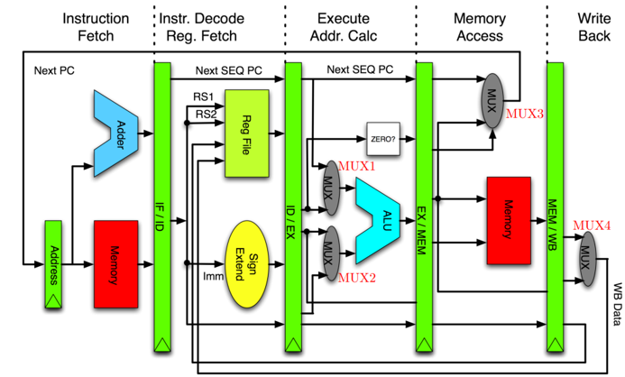
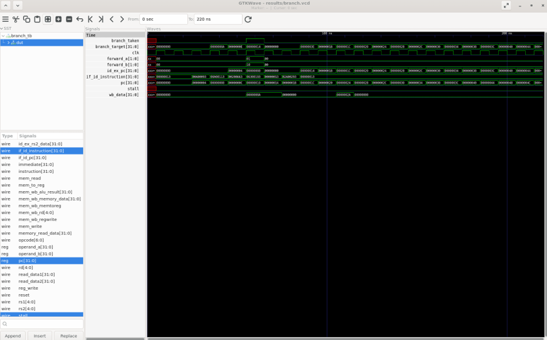

# 5-Stage Pipelined RISC-V Processor with Superscalar Performance Analysis

A Verilog RTL project implementing and simulating a **5-stage pipelined RISC-V processor**, including instruction forwarding, pipeline hazard detection, branch handling, and performance evaluation of single-issue versus dual-issue instruction scheduling.

**Technologies:** Verilog HDL | RISC-V | Icarus Verilog | GTKWave | Linux | Python

> **Project Scope:** The five-stage RISC-V processor and the configurable dual-issue scheduler are implemented as separate simulation models. The project does not implement a fully integrated superscalar CPU or claim complete RISC-V ISA compliance.

---

## 1. Project Overview

The project explores processor pipelining, instruction-level parallelism (ILP), data dependencies, and architectural performance.

The processor follows the classical five-stage RISC-V pipeline:

| Stage | Name | Function |
|---|---|---|
| IF | Instruction Fetch | Fetches instructions from instruction memory |
| ID | Instruction Decode | Decodes instructions and reads registers |
| EX | Execute | Performs ALU operations and branch evaluation |
| MEM | Memory Access | Handles data memory reads and writes |
| WB | Write Back | Writes computed results to registers |

### Implemented Components

- Arithmetic Logic Unit (ALU)
- Register File
- Control Unit and Instruction Decoder
- Immediate Generator
- Instruction and Data Memory
- Pipeline Registers
- Data Forwarding Unit
- Load-Use Hazard Detection
- Branch Handling Logic
- Configurable Single-Issue / Dual-Issue Scheduler

---

## 2. Architecture and Simulation Gallery

Explore the processor architecture, verification waveforms, and superscalar performance experiments.

### Quick Navigation

| Component | Description | Documentation |
|---|---|---|
| Pipeline Architecture | Five-stage processor datapath | [View Architecture](docs/images/pipeline_architecture.png) |
| Processor Simulation | GTKWave functional verification | [View Waveform](docs/images/processor_waveform.png) |
| Dual-Issue Scheduling | Instruction scheduling simulation screenshots | [View Results](docs/images/dual_issue_result/) |
| Performance Analysis | Single-issue versus dual-issue graphs | [View Graphs](docs/images/performance_comparison/) |
| Verification | Testbench verification summary | [View Verification](docs/verification_summary.md) |

### 2.1 Five-Stage RISC-V Pipeline Architecture

The processor uses five pipeline stages with intermediate pipeline registers, forwarding paths, and hazard detection to manage instruction dependencies.

[](docs/images/pipeline_architecture.png)

[View Full Architecture Diagram](docs/images/pipeline_architecture.png)

### 2.2 Processor Simulation and Verification

Functional verification was performed using **Icarus Verilog** and **GTKWave**, including arithmetic operations, register-file operations, pipeline behavior, forwarding, and branch handling.

[](docs/images/processor_waveform.png)

[View Full Processor Waveform](docs/images/processor_waveform.png)

### 2.3 Dual-Issue Instruction Scheduling

A separate configurable scheduler models single-issue and dual-issue instruction selection.

It evaluates instruction pairing based on register-dependency information and measures instruction-issue cycles, IPC, CPI, and speedup.

**Simulation Screenshots:**

- [Dual-Issue Simulation — Screenshot 1](docs/images/dual_issue_result/01_dual_issue_result_screenshot.png)
- [Dual-Issue Simulation — Screenshot 2](docs/images/dual_issue_result/02_dual_issue_result_screenshot.png)
- [Dual-Issue Simulation — Screenshot 3](docs/images/dual_issue_result/03_dual_issue_result_screenshot.png)

[Browse All Dual-Issue Screenshots](docs/images/dual_issue_result/)

### 2.4 Performance Comparison

The scheduling models were evaluated across three eight-instruction workloads to understand the effects of instruction-level parallelism and dependency constraints.

**Performance Graphs:**

[View Performance Comparison Graphs](docs/images/performance_comparison/)

---

## 3. Performance Results

The following results were obtained from the instruction-issue scheduling experiments.

| Workload | Single-Issue Cycles | Dual-Issue Cycles | Single IPC | Dual IPC | Speedup |
|---|---:|---:|---:|---:|---:|
| Independent | 8 | 4 | 1.00 | 2.00 | 2.00× |
| Dependency-Heavy | 8 | 8 | 1.00 | 1.00 | 1.00× |
| Mixed | 8 | 4 | 1.00 | 2.00 | 2.00× |

### Key Observations

- **Independent Instructions:** Dual-issue scheduling achieved an IPC of 2.0 compared with 1.0 for single-issue scheduling.
- **Dependency-Heavy Instructions:** Serial dependencies restricted scheduling to one instruction per cycle, producing no speedup.
- **Mixed Instructions:** The tested dependency pattern allowed instruction pairing, achieving a 2.0× issue-stage speedup.

**Maximum observed speedup: 2.0× for the tested instruction-issue workloads.**

> **Performance Note:** IPC, CPI, and speedup are calculated using scheduler issue cycles. These measurements do not represent complete processor execution, retirement, or end-to-end application performance.

---

## 4. Verification and Testing

The project uses Verilog testbenches to validate individual processor modules and integrated functionality.

### Verification Coverage

- ALU arithmetic and logical operations
- Register-file read/write behavior
- Instruction decoding and immediate generation
- Instruction and data memory operations
- Pipeline register functionality
- Data forwarding
- Load-use hazard detection
- Branch handling
- Single-issue and dual-issue scheduling

### Reported Verification Results

The documented testbenches reported:

- `ALL PROCESSOR TESTS PASSED`
- `ALL BRANCH TESTS PASSED`
- `DUAL ISSUE TEST PASSED`
- `ALL DEPENDENCY TESTS PASSED`

These results indicate successful execution of the supplied testbenches and do not establish complete RISC-V ISA compliance.

[View Verification Summary](docs/verification_summary.md)

---

## 5. Tools and Technologies

| Technology | Purpose |
|---|---|
| Verilog HDL | Processor RTL design and testbenches |
| RISC-V | Processor instruction-set architecture |
| Icarus Verilog | RTL compilation and simulation |
| GTKWave | Waveform visualization and debugging |
| Linux / Ubuntu | Development environment |
| Python / Matplotlib | Performance analysis and visualization |

---

## 6. Repository Structure

```text
riscv-pipeline/
├── rtl/                    # Processor RTL modules
├── tb/                     # Component and processor testbenches
├── superscalar/            # Instruction-issue scheduler and tests
├── programs/               # Instruction memory test programs
├── scripts/                # Performance analysis scripts
├── docs/
│   ├── images/
│   │   ├── pipeline_architecture.png
│   │   ├── processor_waveform.png
│   │   ├── dual_issue_result/
│   │   └── performance_comparison/
│   └── verification_summary.md
├── README.md
└── .gitignore
```

---

## 7. Running the Simulations

### Prerequisites

Install Icarus Verilog, GTKWave, and Python on Ubuntu/Linux.

```bash
sudo apt update
sudo apt install iverilog gtkwave python3 python3-matplotlib
```

### Clone the Repository

```bash
git clone https://github.com/faruki-affan/riscv-pipeline.git
cd riscv-pipeline
```

### Compile and Execute RTL Testbenches

The simulation sources are provided in the `rtl/`, `tb/`, and `superscalar/` directories.

Compile the required Verilog sources using `iverilog`, then execute the generated simulation using `vvp`.

**Example — ALU Testbench:**

```bash
mkdir -p results

iverilog -g2012 -s alu_tb \
  -o results/alu_sim \
  rtl/alu.v tb/alu_tb.v

vvp results/alu_sim
```

The example assumes the testbench top-level module is named `alu_tb`.

For the processor, branch, and superscalar experiments, compile the corresponding modules and testbenches before running their simulations.

The documented simulation outputs use the following commands after compilation:

```bash
vvp results/processor_sim
vvp results/branch_sim
vvp results/dual_issue_sim
vvp results/comparison_sim
vvp results/dependency_sim
```

### View Generated Waveforms

```bash
gtkwave results/dependency.vcd
```

### Generate Performance Plots

```bash
python3 scripts/performance_graphs.py
```

The full set of compilation commands can be consolidated into a future `Makefile` or automated simulation script.

---

## 8. Limitations and Future Improvements

### Current Limitations

- The five-stage processor and dual-issue scheduler operate as separate simulation models.
- Processor verification is limited to the supplied instructions and test programs.
- The scheduler uses simplified dependency and result-availability assumptions.
- Out-of-order execution, register renaming, reorder buffers, and realistic cache hierarchy are not implemented.
- Reported IPC and CPI values represent instruction-issue behavior rather than complete processor retirement.

### Future Improvements

- Integrate a second execution lane into the processor pipeline.
- Extend RV32I instruction and test coverage.
- Implement latency-aware dependency tracking.
- Add automated regression testing.
- Explore FPGA synthesis and timing analysis.

---

## 9. References

- [RISC-V Instruction Set Manual](https://docs.riscv.org/)
- [Icarus Verilog](https://steveicarus.github.io/iverilog/)
- [GTKWave](https://gtkwave.sourceforge.net/)

---

**Project Focus:** Computer Architecture | RISC-V | Processor Pipelining | Verilog RTL | Instruction-Level Parallelism | Performance Analysis
